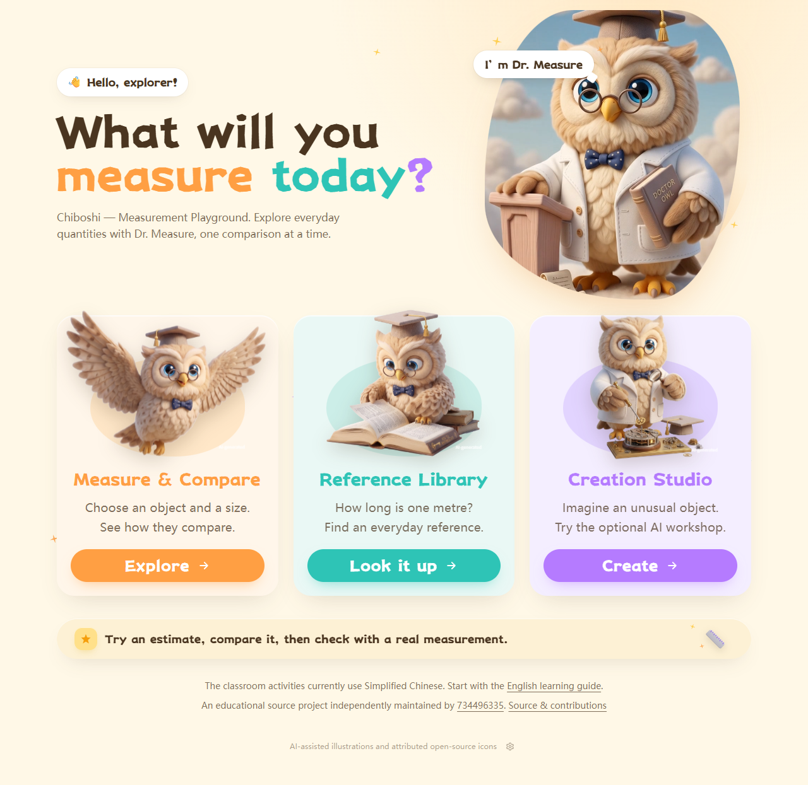

# Chiboshi — Measurement Playground

An educational playground for exploring everyday measurements through visual comparisons.

[中文说明](README.zh-CN.md) · [Getting started](docs/GETTING_STARTED.md) · [Learning guide](docs/LEARNING_GUIDE.md) · [Contributing](CONTRIBUTING.md)

Chiboshi (尺博士) explores a simple question: what does a measurement *look like*? Its activities connect numbers and units to familiar objects across **length, mass, capacity, area, volume, and time**. A deliberately implausible comparison can become a prompt to estimate, discuss, and revise an answer.

The project is independently maintained by [@734496335](https://github.com/734496335) as a local learning resource and a practical example of building educational interfaces with Next.js and TypeScript.



## What you can explore

| Area | Purpose |
| --- | --- |
| Measurement sandbox | Explore quantities and compare scales across six measurement dimensions. |
| Reference dictionary | Browse built-in examples that connect units to everyday objects. |
| Creative workshop | Explore an experimental creation workflow; generated images require a separately configured image backend. |
| Developer examples | Study unit conversion, visual comparison, React interaction, and server-side model integration. |

The intended learning audience includes elementary-age learners with adult guidance. Developers and educators can also inspect, adapt, and discuss the implementation. The activities are exploratory; the project does not claim demonstrated learning outcomes or formal curriculum certification.

## Language and current scope

Project documentation and the main entry page use English. Many activities, reference entries, and model prompts remain in Chinese. Full interface localization is planned work; this is not yet an English-only classroom application.

There is **no maintained hosted demo**. Run the project locally. Built-in pages and reference data can be explored without an API key. AI-dependent interactions require a configured backend; external providers require network access. Some visual assets or dependencies may also make network requests, so a fully offline experience is not guaranteed.

## Run locally

Use **Node.js 22** and npm.

```bash
git clone https://github.com/734496335/chiboshi-edu.git
cd chiboshi-edu
npm ci
npm run dev
```

Open [http://127.0.0.1:3000](http://127.0.0.1:3000).

For optional AI features, copy `.env.local.example` to `.env.local` and configure `LLM_API_KEY`, `LLM_BASE_URL`, and `LLM_MODEL` for your provider. See [Getting started](docs/GETTING_STARTED.md) for setup, validation, and limitations. Never commit API credentials.

## Learn and contribute

- [Learning guide](docs/LEARNING_GUIDE.md): short activities and implementation exercises.
- [Architecture](docs/ARCHITECTURE.md): the main modules and request boundaries.
- [Roadmap](docs/ROADMAP.md): current limitations and future work.
- [Contributing](CONTRIBUTING.md): changes, validation, and review expectations.
- [Maintainers](MAINTAINERS.md): stewardship and attribution.
- [Security](SECURITY.md): local operation and responsible reporting.

## Technology

Next.js 16 App Router, React 19, TypeScript, and Tailwind CSS form the application foundation. Framer Motion, Rough.js, and other visual libraries support the interface. Optional AI features use a server-side client for compatible chat-completion providers. Compatibility depends on the provider and model; it is not a guarantee that every API or model will work.

## Attribution and license

Chiboshi developed from the Chinese-language 尺博士 prototype. AI-assisted coding and generated visual assets are part of its development history. Maintainer responsibility includes reviewing, testing, and documenting those outputs; AI assistance does not replace attribution or verification.

Project source code is available under the [MIT License](LICENSE). Third-party packages and assets retain their own terms; see [Third-party notices](THIRD_PARTY_NOTICES.md). A source-code license does not override those separate terms.
