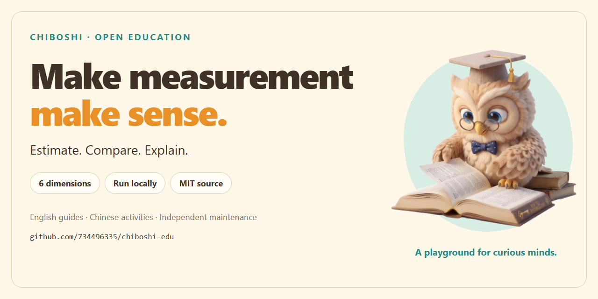
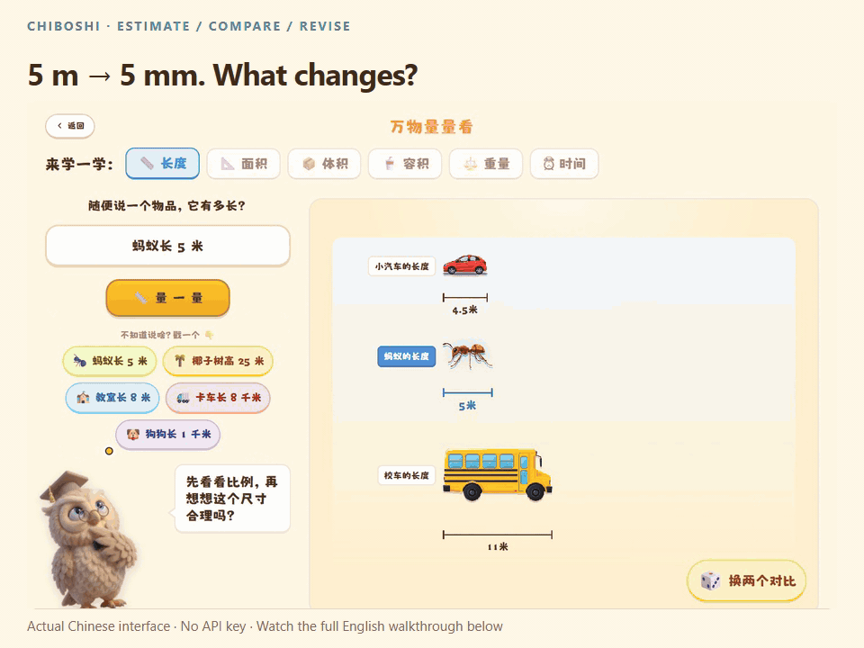
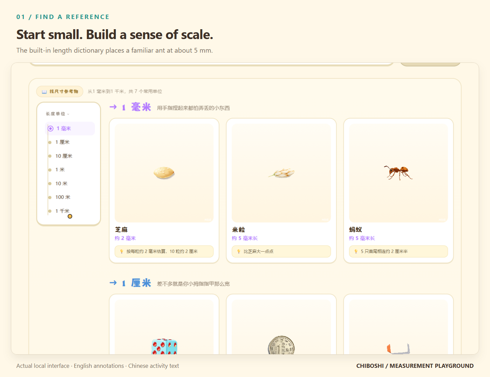
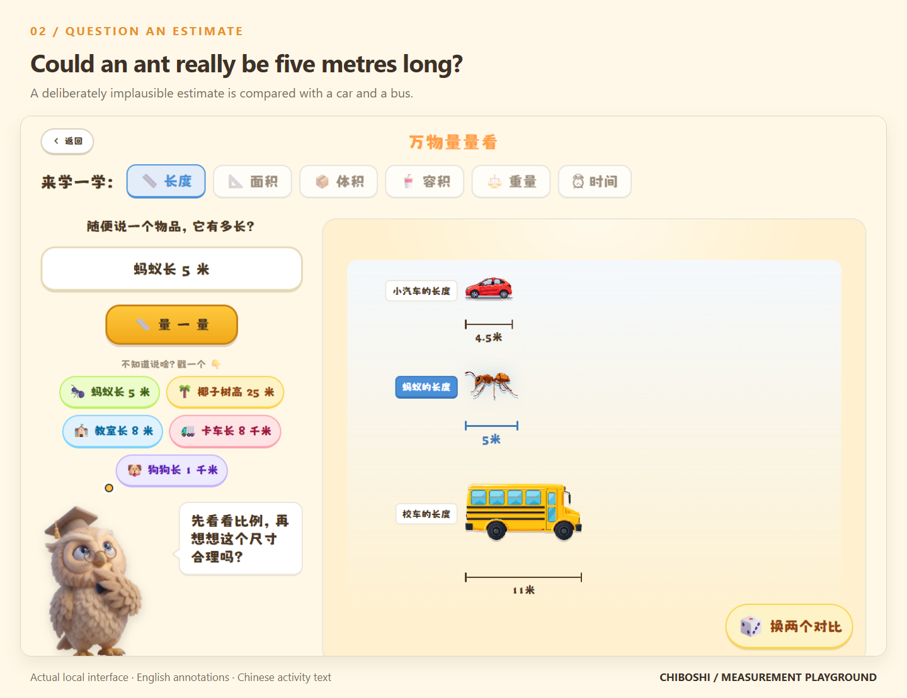
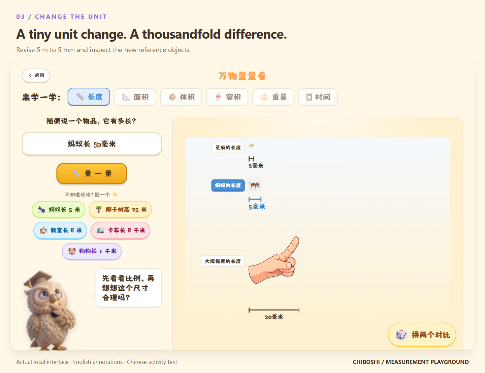
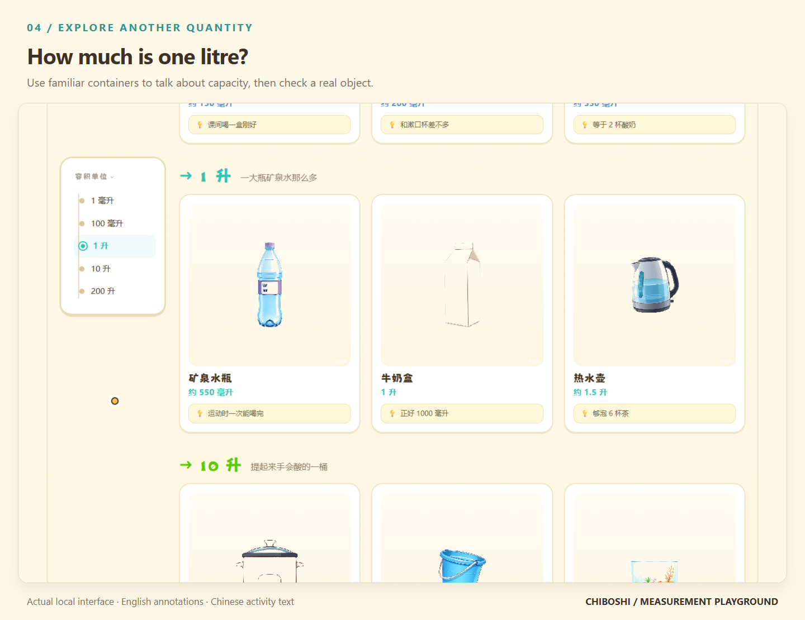

# Chiboshi — Measurement Playground

**Estimate. Compare. Explain.** Build a sense of scale by connecting numbers and units with familiar objects.

[Learning guide](docs/LEARNING_GUIDE.md) · [Run locally](#run-locally) · [Contribute](CONTRIBUTING.md) · [中文说明](README.zh-CN.md)



## What if an ant were five metres long?

Start with a familiar reference, try a deliberately implausible estimate, and change **5 m** to **5 mm**. The numeral stays the same; the length becomes one thousandth as large.

[](docs/media/README.md#focused-unit-change-clip)

*Real local interaction, with English annotations. The current classroom interface is Chinese. [Static preview](docs/media/video-poster.png) · [Transcript](docs/media/transcript.md)*

### Watch the full walkthrough

https://github.com/user-attachments/assets/a7f22919-13b0-4331-a749-0ffd86a8e11a

The walkthrough shows the reference library, an estimate and revision, capacity examples, and how to contribute. It has English explanations and no audio. The recording uses the real local fallback with **no API key**; it is not a demonstration of an AI model checking the answer.

[16-second unit-change clip](https://github.com/user-attachments/assets/3b743335-85b2-4b79-a41a-0cc0c6208fb1) · [Caption file](docs/media/walkthrough.en.vtt) · [Teaching prompts and transcript](docs/media/transcript.md) · [Media kit and reproducible recording](docs/media/README.md)

## Run locally

Use **Node.js 22** and npm.

```bash
git clone https://github.com/734496335/chiboshi-edu.git
cd chiboshi-edu
npm ci
npm run dev
```

Open [http://127.0.0.1:3000](http://127.0.0.1:3000). Start with the built-in reference dictionary.

There is **no maintained hosted demo**. Optional AI features need your own provider configuration; the image workshop also needs a separate image backend. See [Getting started](docs/GETTING_STARTED.md). Never commit credentials.

## A small learning loop

<table>
<tr>
<td width="50%" valign="top">

### 1. Find a reference

[](docs/media/01-reference.png)

Connect a quantity with something familiar. The dictionary's **approximately 5 mm ant** is a starting point for discussion.

</td>
<td width="50%" valign="top">

### 2. Question an estimate

[](docs/media/02-estimate.png)

Would a **5 m ant** make sense next to a car? Use the visual comparison to explain your reasoning.

</td>
</tr>
<tr>
<td width="50%" valign="top">

### 3. Revise and explain

[](docs/media/03-revised.png)

Change **metres to millimetres**. Explain the thousandfold difference, then check a real measurement.

</td>
<td width="50%" valign="top">

### 4. Transfer the idea

[](docs/media/04-capacity.png)

Explore another quantity: **550 mL, 1 L, 1.5 L**. Compare the examples with a labelled container nearby.

</td>
</tr>
</table>

Reference quantities are illustrative and often approximate. Actual objects vary. The activities invite estimation and discussion; the project does not claim demonstrated learning outcomes or formal curriculum certification.

## What you can explore

| Area | Learning or development opportunity |
| --- | --- |
| Measurement sandbox | Compare quantities across length, mass, capacity, area, volume, and time. |
| Reference library | Browse built-in objects, units, and memory prompts. |
| Creation Studio | Inspect an experimental image workflow with an optional local backend. |
| Source code | Study unit conversion, visual comparison, React interaction, and server-side model integration. |

The intended learning audience includes elementary-age learners with adult guidance. Educators and developers can inspect, adapt, and discuss the implementation.

## Make the next lesson better

Useful contributions include checking reference quantities, improving explanations, translating classroom activities, strengthening accessibility, and adding meaningful regression checks.

- [Learning guide](docs/LEARNING_GUIDE.md): activities and implementation exercises.
- [Contributing](CONTRIBUTING.md): development, validation, and review expectations.
- [Roadmap](docs/ROADMAP.md): current limitations and future work.
- [Architecture](docs/ARCHITECTURE.md): modules and request boundaries.
- [Maintainers](MAINTAINERS.md): stewardship and attribution.
- [Security](SECURITY.md): local operation and sensitive reports.

Chiboshi is independently maintained by [@734496335](https://github.com/734496335). It is an early educational source project, open to thoughtful contributions.

## Language and technology

Documentation and the main entry page use English. Many classroom activities, reference entries, and model prompts remain Chinese. Full interface localization is planned.

The application uses Next.js 16, React 19, TypeScript, and Tailwind CSS, with visual libraries including Framer Motion and Rough.js. Optional AI features use compatible chat-completion APIs; provider and model compatibility varies. Some dynamic visual resources can make network requests, so fully offline operation is not guaranteed.

## Attribution and license

Chiboshi developed from the Chinese-language 尺博士 prototype. AI-assisted coding and generated visual assets are part of its history. Maintainer responsibility includes reviewing, testing, and documenting those outputs.

Original project code is available under the [MIT License](LICENSE). Third-party fonts, icons, libraries, and other assets retain their own terms in [Third-party notices](THIRD_PARTY_NOTICES.md). The media uses actual local screen recordings; it does not represent classroom adoption or an online service.
